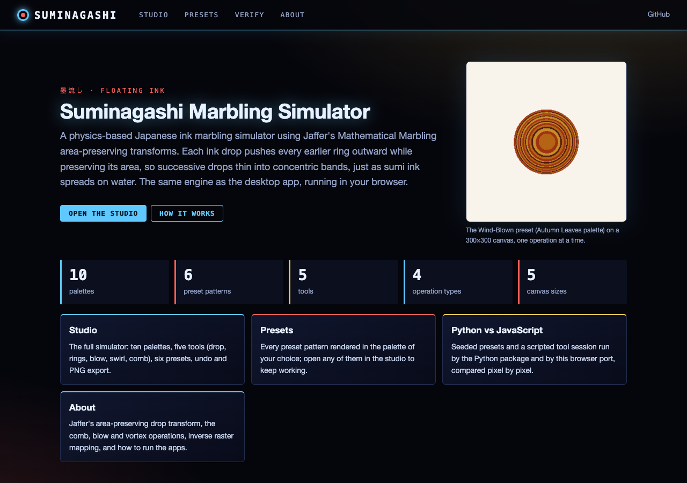
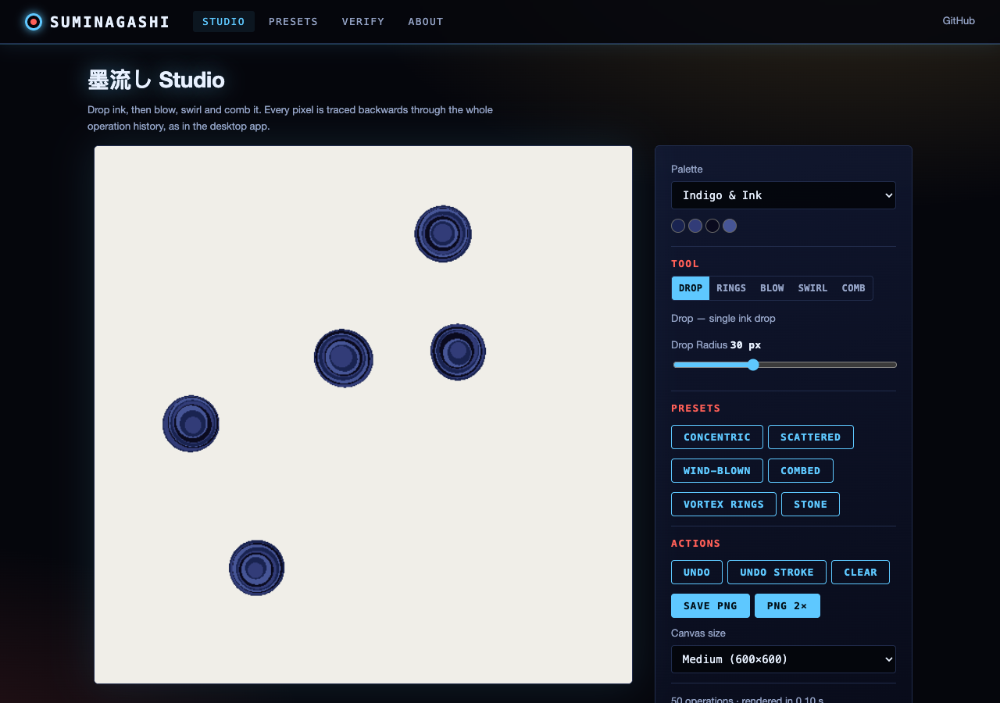
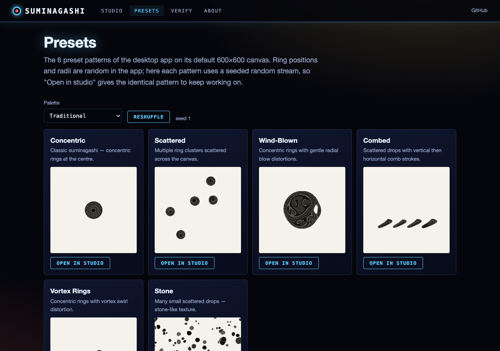
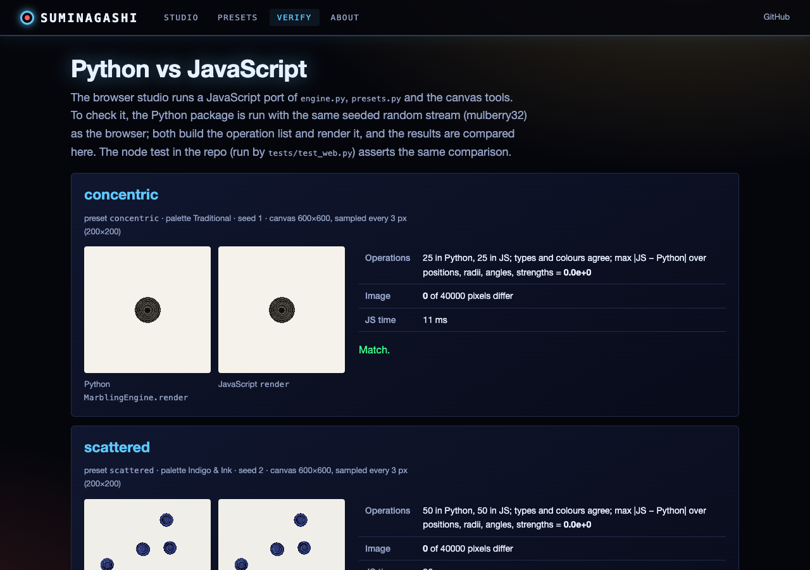

# 墨流し  Suminagashi Marbling Simulator

A physics-based Japanese ink marbling simulator built with Python, PyQt5 and NumPy.

## Physics

The simulation implements **Jaffer's area-preserving drop transform** from
[Mathematical Marbling](https://people.csail.mit.edu/jaffer/Marbling/) (Lu, Jaffer et al., IEEE CG&A 2012).

When an ink drop of radius *r* lands at centre *C*, every point *P* on the
water surface moves radially outward to:

```
P' = C + (P − C) · √(1 + r² / ‖P − C‖²)
```

This preserves the area of all regions not containing *C*, naturally creating
thinning concentric rings as successive drops push earlier ink outward — exactly
matching how real sumi ink spreads on water via surface tension and Marangoni
forces.

Additional transforms include:
- **Comb strokes** — tine displacement with Gaussian perpendicular falloff
- **Blow** — radial outward push with Gaussian falloff (like breathing on water)
- **Vortex** — rotational distortion with Gaussian falloff

Rendering uses **inverse raster mapping**: each pixel traces backward through the
full operation history to determine its colour, producing filled regions with
crisp, sharp boundaries between ink colours.

## Installation

```bash
pip install numpy PyQt5
```

## Usage

```bash
# Default 600×600 canvas
python run_suminagashi.py

# Or as a module
python -m suminagashi

# Custom canvas size
python run_suminagashi.py -W 800 -H 800

# Start with a palette and preset
python run_suminagashi.py --palette indigo --preset concentric

# List available palettes and presets
python run_suminagashi.py --list-palettes
python run_suminagashi.py --list-presets

# Verbose logging
python run_suminagashi.py -v
```

## Tools

| Tool | Action | Description |
|------|--------|-------------|
| **Drop** | Click | Place a single ink drop |
| **Rings** | Click | Place many concentric drops (classic suminagashi) |
| **Blow** | Drag | Push ink outward like breathing on the surface |
| **Swirl** | Drag | Create vortex currents |
| **Comb** | Drag | Rake through the ink |

## Keyboard Shortcuts

- `Ctrl+S` — Save artwork as PNG
- `Ctrl+Z` — Undo last operation
- `Ctrl+Shift+X` — Clear canvas
- `Ctrl+Q` — Quit

## Project Structure

```
suminagashi/                    # repository root
├── run_suminagashi.py          # Quick launcher
├── run_web.py                  # Web app (see "Web version")
├── pyproject.toml
├── README.md
├── suminagashi/
│   ├── __init__.py             # Package metadata
│   ├── __main__.py             # python -m entry point
│   ├── app.py                  # CLI parsing, dependency checks, Qt launch
│   ├── engine.py               # Core marbling engine (numpy-vectorised)
│   ├── palettes.py             # Colour palette definitions
│   ├── presets.py              # Preset pattern generators
│   ├── tool_ops.py             # Tool logic (rings click, blow/swirl/comb drag steps)
│   ├── ui_specs.py             # Tools, sliders, preset labels, canvas sizes
│   ├── canvas.py               # Qt canvas widget + render thread
│   ├── controls.py             # Control panel widget
│   ├── main_window.py          # Main window assembly
│   └── web/                    # Web interface and static site
├── tests/                      # pytest suite
└── _archive/                   # Original monolith and abandoned JSX port
```

## Web version

**Live:** https://gddickinson.github.io/suminagashi/ (static GitHub Pages site; the simulator runs in your browser)

The web version is a JavaScript port of the same engine, presets and canvas tools (`suminagashi/web/static/`),
checked against the Python package: seeded presets and a scripted tool session give the identical operation lists
and pixel-identical renders (the **Verify** page and `tests/test_web.py`).

| Page | What it does |
|------|--------------|
| **Studio** | The full simulator: 10 palettes, the five tools, 6 presets, 5 canvas sizes, undo, PNG export (also at 2×) |
| **Presets** | Every preset in any palette, seeded, with "Open in studio" |
| **Verify** | Python vs JavaScript, side by side, with the differences measured |
| **About** | The transforms, the tools, how to run both apps |






### Run the web app

```bash
pip install -r requirements-web.txt
python run_web.py                  # http://127.0.0.1:8137
```

The local app adds a "Render with Python" button in the studio (`POST /api/render`: the numpy engine renders the
studio's operation list and the page reports how many pixels differ). Build the static site with
`python scripts/build_static.py` (output in `site/`); `.github/workflows/pages.yml` tests and publishes it on every
push to `main`. Tests: `python -m pytest -q tests/` (the web tests also run the node test of the JS port).

## Palettes

10 built-in palettes: Traditional, Sumi Ink, Indigo, Autumn, Ocean,
Sakura, Forest, Twilight, Earth Tones, Fire.

## Presets

6 preset patterns: Concentric, Scattered, Wind-Blown, Combed, Vortex Rings, Stone.

## References

- Lu, Jaffer et al., *Mathematical Marbling*, IEEE CG&A 2012
- Jaffer, *Dropping Paint*, people.csail.mit.edu/jaffer/Marbling/
- Ghassaei, *Digital Marbling*, blog.amandaghassaei.com
- Sun et al., *Hydrodynamics of marbling art*, Phys Rev Fluids 2024


---
*Built with AI assistance from [Claude (Anthropic)](https://claude.com/).*
